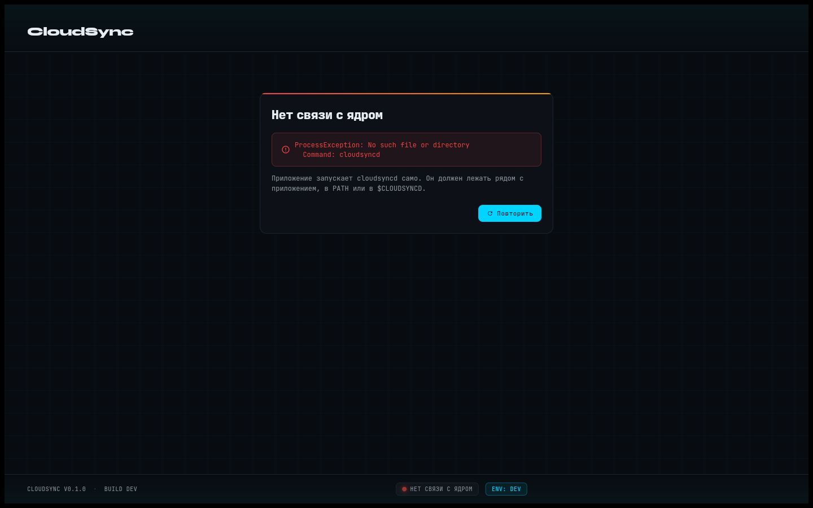

# CloudSync

**English** · [Русский](README.ru.md)

[](https://github.com/Namikko-chad/cloud-storage/actions/workflows/ci.yml)
[](LICENSE)
[](https://github.com/Namikko-chad/cloud-storage/releases)

File sync between Linux, Windows and Android with no server in the middle. Your data
is spread over several cloud storages you already have (Google Drive, Mega, S3, WebDAV,
Dropbox, OneDrive, Yandex Disk and anything else rclone supports, including several
accounts of the same type) with Reed-Solomon k+m redundancy (m=1 works like RAID 5).
Everything is encrypted and decrypted on your devices only.

<p align="center">
  
  &nbsp;
  
</p>

## Features

- **No server.** Devices talk only to the storages. The file tree is a deterministic
  fold of every device's operation journal.
- **Encrypted end to end.** Storages see only objects with random names: no file
  names, no sizes of single files, no content.
- **Survives a lost storage.** Each block is split into k data and m parity shards, one
  per storage. Any m storages can disappear; `repair` rebuilds what is missing.
- **Files on demand.** The full listing is always there; content is downloaded on read,
  only the chunks you need. Pin files or folders to keep them offline.
- **Mounted folder** on Linux (FUSE) and Windows (WinFsp); system file picker on Android.
- **Write locks** across devices, so a file open on one device is read-only on others.
  Concurrent offline edits become conflict copies, never lost edits.
- **Password safe** with passwords, SSH keys, web3 keys (Ethereum/EVM, Solana) and
  2FA (TOTP) codes with recovery codes, synced the same way as files.

## How it works

```
file → FastCDC chunks (~4 MB; small files are packed together)
     → XChaCha20-Poly1305 → Reed-Solomon k+m → one shard per storage
```

- **Vault** (`vault.cs`) is the only configuration file: master key, k/m, storages with
  their credentials, devices. It is encrypted with a key derived from your password
  (Argon2id). A copy lives in every storage, so changes (such as a new storage) reach
  the other devices.
- **A storage is identified by its `id`, not by its type**: two Mega accounts are two
  independent storages. The `domain` field (the type by default) is a failure zone:
  shards of one block are spread across different providers, and `status` warns you
  when losing a single provider would make files unreadable.
- **Index without a server.** Each device writes only its own operation journal
  (`j/<device>/<seq>`, encrypted, a copy in every storage). The file tree is a
  deterministic fold of all operations (Lamport clocks). Concurrent edits of one file
  give a conflict copy, not data loss.
- **Files on demand.** Pins (`cs pin`) keep files or folders on the device; `pin /`
  keeps a full local copy.
- **Locks.** Opening a file for writing puts a lease into every storage. A device owns
  the file when a majority of storages hold no other lease besides its own. While a file
  is open on one device, other devices can open it read-only. A lease expires unless
  renewed (2 min), so a vanished device does not block the file. The decision is made as
  soon as a majority is reached, so a slow storage does not delay opening. After a file
  is closed the lease is kept for 30 s more, so saving again does not take the lock anew.
- **Speed.** All storages are queried in parallel, at most 6 requests at a time per
  storage. A journal write returns once copies are on m+1 storages; the rest are written
  in the background. File blocks are uploaded 4 at a time. Reads take shards from the
  storages that answered faster (response times are shown on the storages screen) and
  ask for one more shard when a storage answers much slower than usual. Sequential reads
  prefetch the next 2 blocks.
- **Maintenance.** `repair` reads every shard (verifying checksums), writes missing ones,
  moves them off disabled storages, re-encodes blocks after a k/m change (a new
  "generation" of shards with new names) and can rebalance data onto new storages. `gc`
  deletes objects that no file has needed for more than 7 days (each device keeps its own
  count, no coordination needed). Each device packs its own journal: every 64 segments
  into one object.
- **Password safe.** Passwords, SSH keys and web3 keys (Ethereum/EVM, Solana), in groups
  with a picture and a name. A record is a `secret` operation in the same device
  journals, so it syncs like the file tree (concurrent edits give a conflict copy of the
  record). Inside the operation two parts are sealed with separate keys derived from the
  master key: metadata (title, login, URL, public key, address) is opened for the list,
  secrets (password, notes, private key, key passphrase) only when the record card is
  open. Only ciphertext reaches the disk (journals, their local copies, `state.json`).
  The core derives the public SSH key, its fingerprint and the web3 address from the
  private key itself.
- **2FA codes (TOTP).** A `totp` record in the same safe: the secret (base32 or an
  `otpauth://totp/…` link), algorithm, digits, period and recovery codes are in the
  sealed part. The core computes the current codes (`TotpCodes`); the secret never goes
  into the list. Recovery codes are pasted as is (numbering, columns, headers and notes
  of the file are dropped); a used code is removed from the record (`UseRecoveryCode`) on
  every device.

## Repository layout

| Path | What |
|---|---|
| `core/crypto` | keys, HKDF, AEAD, HMAC names |
| `core/vault` | password-protected configuration file |
| `core/backend` | storages on top of rclone (+ in-memory for tests) |
| `core/chunker` | keyed FastCDC |
| `core/erasure` | Reed-Solomon and shard placement across domains |
| `core/blob` | encryption + RS + write/read/repair of blocks |
| `core/index` | operations, fold, journals |
| `core/lock` | quorum lease locks |
| `core/secrets` | password safe: record sealing, SSH and web3 public key derivation, TOTP, recovery code parsing |
| `core/engine` | all of the above together: files, cache, pins, sync, repair |
| `core/mount` | FUSE (Linux) / WinFsp (Windows) |
| `core/rpc` | gRPC service for the app (`proto/cloudsync.proto`) |
| `cmd/cs` | CLI |
| `cmd/cloudsyncd` | desktop daemon: gRPC + mount + background sync |
| `mobilebind` | core for Android (`gomobile bind` → AAR) |
| `app/` | Flutter app for Linux, Windows and Android |
| `app/lib/presentation/common` | widgets following `DESIGN_MANIFEST.md` (+ `_MOBILITY` for width < 768) |

## Install

Prebuilt binaries are attached to [GitHub Releases](https://github.com/Namikko-chad/cloud-storage/releases):

- **Linux:** `cs` (CLI), `cloudsyncd` (daemon) and the desktop app bundle. Needs
  `libfuse.so.2` (package `fuse2` / `libfuse2`).
- **Windows:** `cs.exe`, `cloudsyncd.exe`. Needs [WinFsp](https://winfsp.dev/).
- **Android:** APK for arm64 phones (Android 8.0+).

## Build and test

Requirements: Go (version from `go.mod`), a C compiler and FUSE headers for the Linux
mount, Flutter for the app, `protoc` for `make proto`, gomobile and the Android NDK for
`make aar`.

```bash
make test          # go test ./core/...
make race          # the same with -race
make build         # builds/cs, builds/cloudsyncd (Linux, FUSE 2)
make build FUSE_TAGS=-tags=fuse3   # if libfuse3.so.3 is available
make build-windows # builds/windows/*.exe (users need WinFsp)
make proto         # regenerate Go and Dart code from proto
make aar           # core for Android (gomobile, NDK in ~/Android/Sdk/ndk)
make app-test      # flutter analyze + flutter test
make build-linux   # Linux app in builds/linux (cloudsyncd next to it)
make build-apk     # Android APKs in builds/android (builds the AAR first)
make app-run       # run the app in development mode
```

The Windows app is built on Windows: `flutter build windows` in `app/`, then put
`cloudsyncd.exe` from `make build-windows` next to it. WinFsp is required.

## Quick start (CLI)

```bash
export CS_PASSWORD=...          # or you will be prompted
cs init -k 2 -m 1               # 2 data + 1 parity shard: needs ≥3 storages
cs backend add -name "Mega personal" -type mega user=me@x.com pass=...
cs backend add -name "Mega work" -type mega user=work@x.com pass=...
cs backend add -name "S3" -type s3 provider=AWS access_key_id=... secret_access_key=... region=eu-central-1 bucket_acl=private
cs backend add -name "MinIO" -type s3 -domain minio-home -root cloudsync \
  provider=Minio endpoint=http://nas.local:9000 access_key_id=... secret_access_key=...
cs backend add -name "Drive" -type drive token='{...}'   # token from `rclone authorize drive`
cs status
cs put ~/Documents /
cs ls -l /Documents
cs pin /Documents               # keep it on this device
cs get /Documents/report.pdf .
cs repair                       # write missing shards, move them off disabled storages
```

Maintenance:

```bash
cs repair [-rebalance]          # verify everything, repair; -rebalance spreads data onto new storages
cs redundancy -k 2 -m 2         # new scheme for new files, then run cs repair
cs gc                           # delete data unused for more than 7 days (-grace 168h)
cs backend reconnect ID         # OAuth token expired or revoked: sign in to the same account again
```

For `-type local` the folder is given with an absolute `-root`. Unknown options are
rejected.

S3-compatible servers (MinIO, Ceph, …): `-root` is `bucket[/folder]`; the bucket is
created on first write if the key may do it. The account of an S3 storage is
`access_key_id@endpoint host`, so two storages on one server need different keys.
Give a self-hosted server its own `-domain`: otherwise it shares the failure zone
`s3` with every other S3 storage.

A storage whose sign-in expired (401, “invalid_grant”) keeps its ID and data: in the
app use “Reconnect” on the Storages screen, or `cs backend reconnect ID`. Signing in
to another account is refused.

## App

One Flutter app on every platform, the same core underneath:

- **Linux, Windows.** The app is a client of the `cloudsyncd` daemon. It reads the
  address and token from `<config dir>/cloudsync/endpoint.json`. If the daemon is not
  running, the app starts it: it looks next to its own binary, in `$CLOUDSYNCD` or in
  `PATH`. After unlocking, the daemon mounts the vault at `~/CloudSync`. "Open" in the app
  opens the file in that folder, so edits are saved and the file is locked meanwhile.
  Closing a file does not wait for the upload: the file is first written to an on-disk
  queue, then uploaded in the background and read from the local copy until then. If the
  daemon dies before the upload finishes, it continues on the next start.
- **Android.** The core runs inside the app: AAR from `make aar`, a foreground service,
  gRPC over a unix socket in the app's private folder. The vault is visible in the system
  file picker (DocumentsProvider). Reads are streamed, only the needed parts are
  downloaded. A write takes the vault lock and uploads the file when the other app
  closes it.
- **Screens:** unlock and first setup (new vault or a file from another device);
  passwords (groups, record card, password generator, copy with clipboard clearing after
  30 s; a "2FA codes" mode with live codes and recovery codes); files (upload, open,
  "keep on device", rename, delete, who holds a file open, conflict copies and resolving
  them, search); storages (state, add wizard with browser sign-in for Drive, OneDrive and
  Dropbox, disable, remove); maintenance (sync, "keep everything on device", verify and
  repair, k/m change, cleanup, devices); vault (change password, export the vault file
  for a new device, lock).
- **A new vault** opens right away but works only with k+m storages. Until then the app
  shows the storages screen.
- **Browser sign-in** (OAuth): the core starts an rclone server on `127.0.0.1:53682` and
  the app opens the link. The browser must be on the same device.

A new device needs the `vault.cs` file (export it on the Vault screen) and the password.

Screenshots of every screen at 1440 and 390 px against a running daemon:
`SHOTS=/tmp/shots flutter run -d linux -t tool/screenshots.dart` (in `app/`).

## Current limitations

- Deleted and old versions of safe records stay in the journal (encrypted) until the
  journal is folded into a snapshot. Decrypted passwords live in the memory of the core
  and the app while the card is open; Go and Dart cannot guarantee wiping strings, and
  memory may end up in swap.
- Locks are "almost always": an offline device does not see them; such edits become
  conflict copies.
- Old file versions are kept only until GC (7 days): there is no version history in
  the UI.
- The journal is packed but not folded into a tree snapshot: the operation history
  grows (kilobytes per thousands of edits).
- Browser sign-in works only where the browser is on the same device. In the CLI,
  OAuth storages need a ready `token` from `rclone authorize`.
- Windows has not been tested live: the Go part cross-compiles, the Flutter build must be
  done on Windows.
- Android has no mounted folder: files are visible through the system file picker
  (DocumentsProvider) and in the app itself.

## Contributing

See [CONTRIBUTING.md](CONTRIBUTING.md). Security issues: [SECURITY.md](SECURITY.md).
Changes are listed in [CHANGELOG.md](CHANGELOG.md).

## License

CloudSync is licensed under the [GNU General Public License v3.0](LICENSE). The fonts
in `app/assets/fonts` are under the SIL Open Font License (`OFL-*.txt` next to them).
